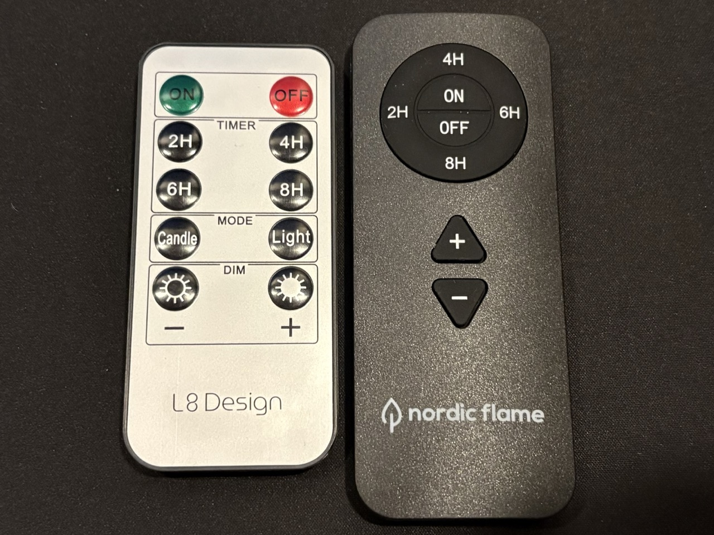

# Nordic Flame

Home Assistant integration for Nordic Flame and L8 Design LED candles with an IR remote. Replaces or complements the physical remote: sends commands through any infrared emitter entity (e.g. ESPHome) and can listen to the physical remote through an infrared receiver entity.

The integration uses the L8 Design remote's codes, because its On/Off keys switch both L8 Design and Nordic Flame candles. The Nordic Flame remote (the same one that ships with Deluxe Homeart candles) only switches Nordic Flame (and Deluxe Homeart) candles. The Candle/Light mode keys also come from the L8 Design remote; the Nordic Flame remote doesn't have them, but Nordic Flame candles still react to the commands.

Requires a Home Assistant version with the `infrared` integration.

## Entities

- Light: on/off, effects Candle and Steady light (assumed state)
- Buttons: Dim up, Dim down, Timer 2h/4h/6h/8h, Candle, Light
- Event: fires on presses from the physical remote (only if a receiver is selected)

## Install

HACS → three-dot menu → Custom repositories → add `https://github.com/cklit/Nordic-Flame-Infrared`, type Integration. Install, restart Home Assistant, then add Nordic Flame under Settings → Devices & services.

## IR codes

NEC extended, address 0xB708, 38 kHz.

| Key | Command |
|---|---|
| On | 0x00 |
| Off | 0x02 |
| 2H | 0x04 |
| 4H | 0x06 |
| 6H | 0x08 |
| 8H | 0x0A |
| Candle | 0x0C |
| Light | 0x0E |
| Dim down | 0x10 |
| Dim up | 0x12 |
